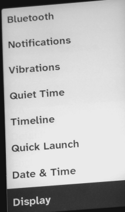
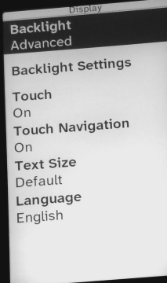
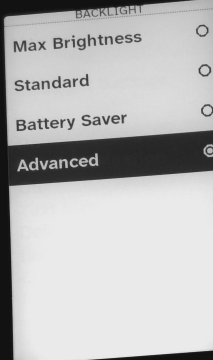
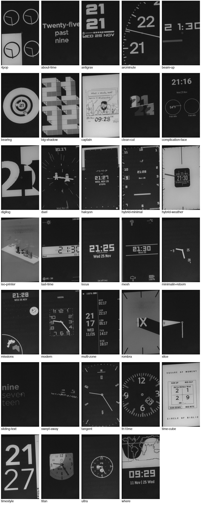

  

  
  
  

## Xteink X4 and X4 Pro

[Flash a reader, install watchfaces, or build the firmware, SDK and Android companion](extras/xteink/README.md). The original X4 uses RISC-V and the X4 Pro uses Xtensa. The downloadable 34-watchface collection targets the Pro.

Firmware updates for both readers require **USB**. PBZ over-the-air firmware updates are unavailable. The Android companion supports installing PBW apps and watchfaces over Bluetooth.

### Help improve the e-paper display

We’d love help making scrolling, animation and small text look better on both readers. Our target is **20 visible updates per second with a clear image**. So far the result depends on what moves and how much of the panel changes. These are hardware measurements from driver development.

| Reader | What we tried | What reached the panel |
| --- | --- | --- |
| X4 · SSD1677 | Short differential waveforms for small changes, with a longer refresh for large or static changes | A 48 × 48 patch reached 20.0 updates/s over 64 frames. Native TetrisTime reached 13.7 updates/s with the default two-frame waveform and 16.5 with a lighter waveform. |
| X4 Pro · UC8279 | Fast monochrome updates during motion, followed by a local repair of the tiles that changed. Menu highlights get a fast preview before the grayscale text pass. | In a tuned four-second TetrisTime benchmark, native code averaged 14 updates/s and peaked at 20 for one second. The comparable ARM build averaged 10.25. A separate test with the face’s own timer recorded 27 panel drives in four seconds. |

**Ghosting is still visible during motion.** On the Pro, falling blocks left bright tracks on black. After local repair, the share of one measured digit column more than 15 luma levels brighter than nearby black fell from 54% to 0%. In Settings, the camera saw all five highlights in each trial at 2, 4 and 6 presses/s from a settled screen. Start pressing during the roughly 850 ms grayscale pass and intermediate highlights can still disappear.

Can you keep those highlights visible during grayscale, shorten the time until text settles, or sustain 20 updates/s with a real watchface? Try a change on either reader and share the board, workload, panel timing and a short before/after video. The emulator is useful for checking what the OS drew. A camera shows what the ink actually did. [X4 driver](drivers/display/ssd1677.c) · [Pro driver](drivers/display/uc8279_x4.c) · [Run the emulator](#run-pebbleos-in-the-emulator)

### Help improve fonts

Claude Code added a high-resolution Atkinson Hyperlegible Next path for the system UI. The font generator stores a compact monochrome glyph plus **4-bit coverage** along its edges. On the Pro, the renderer uses that coverage at the physical **480 × 800** resolution while apps keep their 240 × 400 layout. The panel has four measured tones. The 16 coverage values let the renderer make finer decisions about where an edge falls.

Font and graphics contributors are welcome. Small labels, thin strokes and white text on a dark selection are good places to start. Try different hinting, weights or coverage-to-tone mappings, and share close-ups of the same Settings screen alongside the resource-size and refresh-time changes. [Font generator](tools/font/fontgen.py) · [Text renderer](pebble/applib/graphics/text_grey.c) · [Pro grayscale driver](drivers/display/uc8279_x4_grey.c)

### PebbleOS on the X4 Pro

Settings, Display and Backlight, photographed on the physical Pro:

  
  
  

### Run PebbleOS in the emulator

You can build and run the X4 (RISC-V) or X4 Pro (Xtensa) firmware on your computer. Use Espressif’s QEMU to navigate the menus, install a native watchface and run the integration samples. Both targets have a virtual display; panel ghosting and refresh timing need a physical reader. [Emulator setup, build and test instructions](extras/xteink/README.md#run-the-xteink-emulators)

## Resources

Here's a quick summary of resources to help you find your way around:

### Getting Started

- 📖 [Documentation](https://pebbleos.readthedocs.io/latest)
- 🚀 [Quickstart](https://pebbleos.readthedocs.io/latest/getting_started/index.html)

### Code and Development

- ⌚ [Source Code Repository](https://github.com/coredevices/PebbleOS)
- 🐛 [Issue Tracker](https://github.com/coredevices/PebbleOS/issues)
- 🤝 [Contribution Guide](CONTRIBUTING.md)

### Community and Support

- 💬 [Discord](https://discordapp.com/invite/aRUAYFN)
- 👥 [Discussions](https://github.com/coredevices/PebbleOS/discussions)
